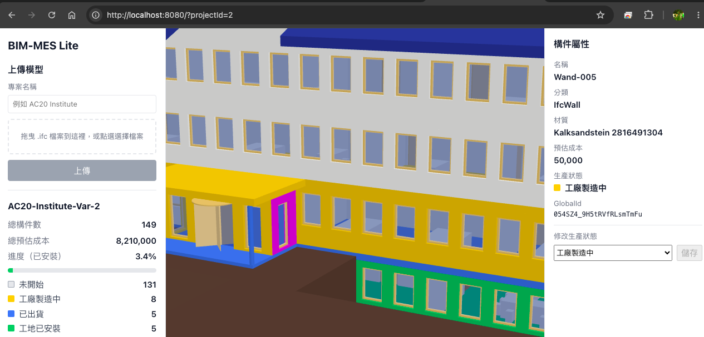

# BIM-MES Lite

BIM 預製構件的生產進度與成本追蹤系統。上傳建築模型（`.ifc`）後，後端解析其中的牆、柱、梁、樓板並寫入資料庫；前端以 3D 顯示模型，依生產狀態為構件上色，點選構件即可查看屬性並更新狀態。

這是個人作品集專案，用來練習 ASP.NET Core 與 Vue 3 的全端開發，以及與 AI 程式助手（Claude Code）分工的開發流程。

**本 repo 只包含說明文件，不含原始碼。** 內容：

- 本文件：功能、技術棧、架構、原始碼結構、測試與資安做法。
- [docs/ai-collaboration.md](docs/ai-collaboration.md)：與 Claude Code 的協作方式。

## 與 AI 協作

程式碼大部分由 Claude Code 的子代理撰寫：一個負責實作，另一個只讀不改、負責驗證。我負責規格、決定，以及在瀏覽器確認畫面。

協作方式分兩個時期：
- **階段一～五：**逐任務進行。每個任務的回報、差異、驗證結果都和我確認，我讀 diff 後自己 commit。
- **階段六起：**整個階段交給 Claude Code 處理。開始前先問我可能要決定的問題；進行中遇到需要決定的事仍會停下來問（階段六發生過三次）；每個任務通過後由它 commit（不推送）；最後交付各任務的結果，由我確認這個階段是否完成。到目前為止，還沒有出現需要大規模調整、影響整個階段的協調。

Claude Code 的建議我不一定照單全收。例如：
- 測試後要等 3～7 分鐘才能回到開發，Claude 說明這是容器掛載路徑不同造成的；我認為開發效率無法接受，要求查外部資料改善。後來查出主因是 Docker 長時間運作後變慢，並消除了每次約 50 秒的重新編譯。
- 上傳上限、頻率限制、名稱長度原本直接依規格實作；我要求這些數值只在一處設定，方便日後調整與測試。
- Claude 建議為「刪除資料庫後重建失敗」加自動重試；我判斷那是初始化才會發生的流程，不需要，改成重置時只清空資料表。

完整的分工、流程，以及每一次與建議不同的回應和原因，見 [docs/ai-collaboration.md](docs/ai-collaboration.md)。

## 功能

- 上傳 `.ifc` 檔（拖曳或選擇檔案），後端解析出可追蹤構件（`IfcWall`、`IfcColumn`、`IfcBeam`、`IfcSlab`）並寫入 SQLite。
- 專案總覽：總構件數、總預估成本、各狀態數量、安裝進度百分比。
- 3D 檢視：旋轉、縮放、平移；依生產狀態上色（未開始＝原色、工廠製造中＝黃、已出貨＝藍、工地已安裝＝綠）。
- 點選構件：側邊欄顯示名稱、分類、材質、預估成本、狀態，可直接修改生產狀態，畫面與統計同步更新。
- 以網址 `?projectId=<id>` 重新開啟專案。

預估成本是依構件分類給的固定模擬金額，不是實際估價。

### 畫面

專案總覽與 3D 檢視（範例模型 AC20-Institute-Var-2）：左側是上傳與統計，右側模型依生產狀態上色。


點選構件後，右側欄顯示屬性，並可修改生產狀態。



## 技術棧

| 層 | 使用技術 |
|---|---|
| 後端 | ASP.NET Core Web API（.NET 8）、Entity Framework Core 8（Code-First + Migration）、SQLite |
| IFC 解析 | Xbim.Essentials |
| 前端 | Vue 3（Composition API）、TypeScript、Vite |
| 3D | @thatopen/components、web-ifc、Three.js |
| 測試 | 後端 xUnit + `WebApplicationFactory`（記憶體內 SQLite）；前端 Vitest + @vue/test-utils + jsdom |
| 開發環境 | Docker、Docker Compose（所有建置、測試、執行都在容器中） |

選擇 SQLite 是因為開發機只有 8GB RAM，無法同時負擔 SQL Server 容器。資料存取透過 EF Core，日後換成其他資料庫時主要改動在連線設定與 Migration。

## 架構

```text
瀏覽器
  │
  ▼
Vue 3 前端（Vite dev server，/api 與 /uploads 經 proxy 轉發，同源，不啟用 CORS）
  │
  ▼
ASP.NET Core Web API
  ├─ IIfcParsingService     → XbimIfcParsingService（解析 .ifc）
  ├─ IFileStorageService    → LocalFileStorageService（存原始 .ifc）
  └─ AppDbContext (EF Core) → SQLite
```

上傳流程：檢查大小與檔頭（STEP 標記）→ 解析 → 檢查 GlobalId 是否已存在（重複上傳回 409）→ 儲存檔案 → 寫入資料庫。先解析再存檔，壞檔與重複上傳不會留下孤兒檔案。

檔案儲存以介面抽象，目前只有本機目錄的實作；原本規劃的 MinIO（S3 相容）實作已暫緩。

### API

| 方法 | 路徑 | 說明 |
|---|---|---|
| POST | `/api/projects/upload` | 上傳 `.ifc` 與專案名稱，回傳解析統計 |
| GET | `/api/projects/{projectId}` | 專案資訊、模型檔 URL、各狀態數量與總成本 |
| GET | `/api/projects/{projectId}/elements` | 專案所有構件與狀態 |
| GET | `/api/elements/{globalId}` | 單一構件 |
| PUT | `/api/elements/{globalId}/status` | 更新生產狀態（0～3） |
| GET | `/api/settings/upload` | 前端需要的上傳上限 |

錯誤一律回 ProblemDetails（`application/problem+json`），需要前端辨識的錯誤帶固定的 `type`（例如 `urn:bim-mes:not-step-file`）。

## 原始碼結構

原始碼不在本 repo，以下是私有 repo 的目錄結構，供了解程式的組織方式。

```text
.
├── backend/                     ASP.NET Core Web API
│   ├── Controllers/             Projects、Elements、Settings
│   ├── Data/                    AppDbContext
│   ├── Models/                  BimProject、BimElement、ProductionStatus
│   ├── Dtos/                    請求與回應模型
│   ├── Services/
│   │   ├── Ifc/                 IFC 解析（介面＋Xbim 實作）
│   │   └── Storage/             檔案儲存（介面＋本機實作）
│   ├── Validation/              GlobalId 格式、STEP 檔頭檢查
│   ├── Middleware/              安全標頭
│   ├── RateLimiting/            上傳頻率限制的分區鍵
│   ├── Options/                 強型別設定
│   └── Migrations/              EF Core Migration
├── frontend/                    Vue 3 + Vite + TypeScript
│   └── src/
│       ├── api/                 API client 與型別
│       ├── components/          UploadPanel、ProjectSummary、InspectorPanel、IfcViewer
│       ├── constants/           生產狀態（數值、名稱、顏色）
│       └── security/            禁止 v-html／innerHTML 的檢查測試
├── tests/BimMes.Api.Tests/      後端單元與整合測試、手寫的小型 IFC 測試檔
├── scripts/security-scan.sh     套件弱點掃描（後端與前端）
├── tutor/                       規格、設計決定、任務清單等協作文件
├── .claude/                     Claude Code 子代理與指令定義
└── docker-compose.yml           開發用服務（後端 dotnet watch、前端 Vite）
```

## 開發環境

開發機是舊款 Intel Mac（8GB RAM），無法安裝新版 .NET SDK 與 Node.js，因此本機只裝 Docker Desktop：

- 開發時以官方映像檔（`mcr.microsoft.com/dotnet/sdk:8.0`、`node:24-alpine`）掛載原始碼執行，後端用 `dotnet watch`、前端用 Vite dev server 熱重載。
- 建置、測試、套件安裝、弱點掃描也都在容器中執行。
- 記憶體有限，同一時間只跑一個建置或測試容器。

後端採同步解析，約 10MB 的範例模型上傳需要 30～40 秒。

## 測試

截至 2026-11-19：後端 102 個測試方法（含參數化），前端 71 個測試案例。

- 後端：服務層的單元測試，以及用 `WebApplicationFactory` 對每支 API 的成功與主要錯誤路徑做整合測試。
- 整合測試以記憶體內 SQLite 與暫存目錄執行，不讀寫實際的資料庫與上傳目錄。
- 測試用 IFC 是手寫的極小檔（已知構件數與成本），可以精確斷言解析結果。
- 前端：API client（以 mock 取代 `fetch`）、狀態常數、三個面板元件。
- 3D 檢視器需要 WebGL，jsdom 無法執行，**不在自動化測試範圍**，以人工在瀏覽器確認。
- 沒有瀏覽器 E2E 測試（考量開發機記憶體）。

## 資訊安全

系統目前**沒有登入**，任何能連線的人都能上傳與修改狀態，因此不應直接對網際網路開放。已實作的防護用來降低異常輸入的影響，每一項都有對應的自動化測試：

- 上傳大小上限（413）、每個 IP 的上傳頻率限制（429）、專案名稱長度上限。
- 檔案內容檢查：只接受 STEP 格式的 `.ifc`（檢查檔頭 `ISO-10303-21;`）。
- 儲存檔名由伺服器產生（`{GUID}.ifc`），不使用原始檔名。
- 路由參數 `globalId` 與狀態值的格式驗證。
- 非 Development 環境不回傳堆疊追蹤；Swagger 只在 Development 啟用。
- 安全標頭（`nosniff`、`X-Frame-Options: DENY`、`Referrer-Policy: no-referrer`）；`/uploads` 只提供 `.ifc`。
- 前端不以 `v-html`／`innerHTML` 顯示資料（以測試檢查原始碼）。
- 套件弱點掃描腳本（後端 `dotnet list package --vulnerable`、前端 `npm audit`），每個階段結束時執行。

上限數值集中在 `appsettings.json`，可用環境變數覆寫，前端從 API 取得而不另外寫死。

## 開發進度

| 階段 | 內容 | 狀態 |
|---|---|---|
| 一～三 | 容器化開發環境、IFC 解析與 API、前端 3D 互動（MVP） | 完成 |
| 四 | MinIO 物件儲存 | 暫緩（官方映像檔已無法取得） |
| 五 | 自動化測試 | 完成 |
| 六 | 資訊安全基本防護 | 完成 |
| 七 | 正式版映像檔（多階段建置、nginx、非 root）與部署用 compose | 進行中 |
| 八 | 登入、使用者與角色權限 | 未開始 |

## 已知限制

- 沒有身分驗證與權限控管（階段八）。
- IFC 解析是同步處理，大型模型會讓上傳請求等待較久；沒有背景工作佇列。
- 只追蹤牆、柱、梁、樓板四類構件；門、窗等其他構件可以顯示但不記錄狀態。
- 成本為模擬值。
- 開發環境只有 HTTP。
