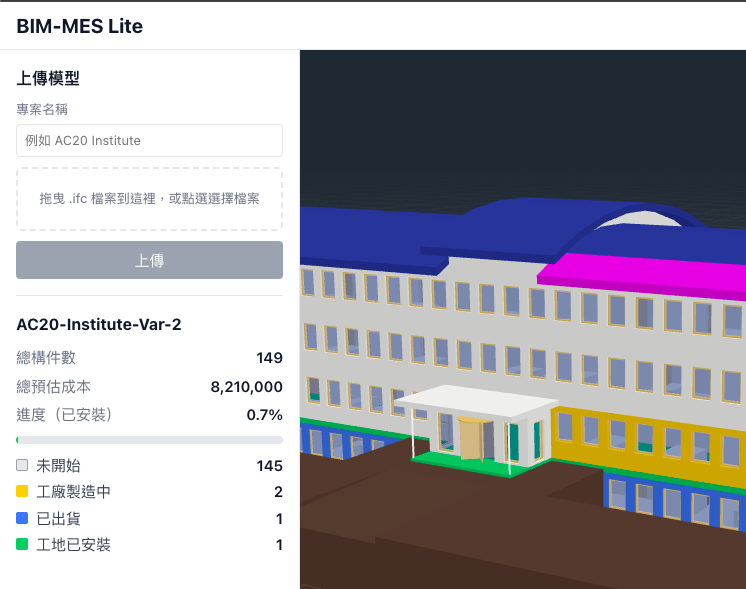
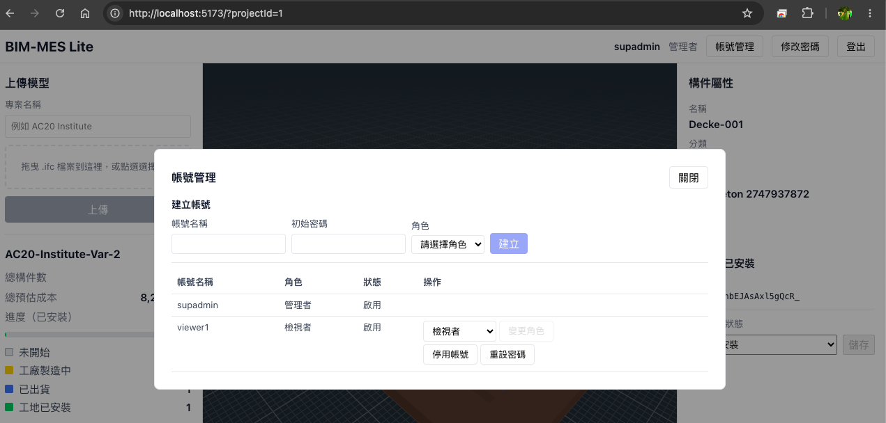

# BIM-MES Lite

BIM 預製構件的生產進度與成本追蹤系統。上傳建築模型（`.ifc`）後，後端解析其中的牆、柱、梁、樓板並寫入資料庫；前端以 3D 顯示模型，依生產狀態為構件上色，點選構件即可查看屬性並更新狀態。使用者需登入，可執行的操作依角色的功能權限決定。

這是個人作品集專案，用來練習 ASP.NET Core 與 Vue 3 的全端開發，以及與 AI 程式助手（Claude Code）分工的開發流程。

**本 repo 只包含說明文件，不含原始碼。** 內容：

- 本文件：功能、技術棧、架構、原始碼結構、測試、資安與部署做法。
- [docs/ai-collaboration.md](docs/ai-collaboration.md)：與 Claude Code 的協作方式。
- [docs/backend-architecture.md](docs/backend-architecture.md)：後端的分層、請求管線、資料表與欄位，以及每支 API 讀寫哪些資料表（供接手的開發者參考）。

## 與 AI 協作

程式碼大部分由 Claude Code 的子代理撰寫：一個負責實作，另一個只讀不改、負責驗證。我負責規格、決定，以及在瀏覽器確認畫面。

這套分工是專案開始時，我詢問能否導入多專案代理工具 Firstmate，Claude 評估後建議的做法：我的需求只有一個專案，改用 Claude Code 內建的子代理就能做到「分派、驗證、回饋、再驗證」，不必另外安裝工具，設定也跟著專案進 git。詳細經過見[這套分工的由來](docs/ai-collaboration.md#這套分工的由來2026-11-13)。

協作方式分兩個時期：
- **階段一～五：**逐任務進行。每個任務的回報、差異、驗證結果都和我確認，我讀 diff 後自己 commit。
- **階段六～八：**整個階段交給 Claude Code 處理。開始前先問我可能要決定的問題；進行中遇到需要決定的事仍會停下來問；每個任務通過後由它 commit（不推送）；需要在瀏覽器確認的項目集中請我確認；最後交付各任務的結果，由我確認這個階段是否完成。階段八在瀏覽器確認與資安複查後，追加了五個任務（T74～T78）。到目前為止，還沒有出現需要推翻整個階段規劃的協調。
- **階段八之後的小任務：**不屬於任何階段的小改進（例如 T79～T82 的 Swagger 改善），回到逐任務進行：我提出需求，Claude Code 寫成任務，我同意後才執行；每個任務通過後由我 commit，再開始下一個。

Claude Code 的建議我不一定照單全收。例如：
- 測試後要等 3～7 分鐘才能回到開發，Claude 說明這是容器掛載路徑不同造成的；我認為開發效率無法接受，要求查外部資料改善。後來查出主因是 Docker 長時間運作後變慢，並[消除了每次約 50 秒的重新編譯](docs/ai-collaboration.md#繼續追查-50-秒的重新編譯並先查外部資料2026-11-18)。
- 上傳上限、頻率限制、名稱長度原本直接依規格實作；我要求[這些數值只在一處設定](docs/ai-collaboration.md#可調整的數值只改一處2026-11-18)，方便日後調整與測試。
- Claude 建議為「刪除資料庫後重建失敗」加自動重試；我判斷那是初始化才會發生的流程，不需要，[改成重置時只清空資料表](docs/ai-collaboration.md#不為刪除資料庫後的重建做自動重試2026-11-15)。
- 規劃登入時，Claude 依角色名稱授權；考量日後要加 2FA、可能新增角色，我要求[改成「角色 → 功能權限」並加上角色權重](docs/ai-collaboration.md#授權改成功能權限與角色權重2026-11-19)。

完整的分工、流程，以及每一次與建議不同的回應和原因，見 [docs/ai-collaboration.md](docs/ai-collaboration.md)。

## 功能

- **登入：**帳號密碼登入，不開放自行註冊。首位管理者在第一次啟動時由環境變數建立，其他帳號由管理者建立。
- **權限：**三種角色（Admin、Operator、Viewer），程式依功能權限（例如「上傳模型」「修改狀態」）決定可執行的操作，畫面也只顯示有權限的操作。
- **上傳模型：**上傳 `.ifc` 檔（拖曳或選擇檔案），後端解析出可追蹤構件（`IfcWall`、`IfcColumn`、`IfcBeam`、`IfcSlab`）並寫入 SQLite。
- **專案總覽：**總構件數、總預估成本、各狀態數量、安裝進度百分比。
- **3D 檢視：**旋轉、縮放、平移；依生產狀態上色（未開始＝原色、工廠製造中＝黃、已出貨＝藍、工地已安裝＝綠）。
- **點選構件：**側邊欄顯示名稱、分類、材質、預估成本、狀態，可直接修改生產狀態，畫面與統計同步更新。
- **帳號管理：**建立帳號、改角色、停用／啟用、重設密碼、解除登入失敗造成的暫時鎖定；使用者可自行修改密碼。
- 以網址 `?projectId=<id>` 重新開啟專案。

預估成本是依構件分類給的固定模擬金額，不是實際估價。

### 畫面

專案總覽與 3D 檢視（範例模型 AC20-Institute-Var-2）：左側是上傳與統計，右側模型依生產狀態上色。



點選構件後，右側欄顯示屬性，並可修改生產狀態。上方列顯示登入者與角色，以及帳號管理、修改密碼、登出。


帳號管理（以首位管理者登入）：可建立帳號，並對其他帳號改角色、停用、重設密碼。自己這一列沒有操作，因為任何人都不能透過帳號管理處理自己。



## 技術棧

| 層 | 使用技術 |
|---|---|
| 後端 | ASP.NET Core Web API（.NET 8）、Entity Framework Core 8（Code-First + Migration）、SQLite |
| 身分驗證 | ASP.NET Core Identity（帳號、密碼雜湊、鎖定）、JWT Bearer |
| IFC 解析 | Xbim.Essentials |
| 前端 | Vue 3（Composition API）、TypeScript、Vite |
| 3D | @thatopen/components、web-ifc、Three.js |
| 測試 | 後端 xUnit + `WebApplicationFactory`（記憶體內 SQLite）；前端 Vitest + @vue/test-utils + jsdom |
| 開發環境 | Docker、Docker Compose（所有建置、測試、執行都在容器中） |
| 正式版 | 多階段建置的映像檔（非 root 執行）、nginx（前端靜態檔與反向代理）、自架 registry |

選擇 SQLite 是因為開發機只有 8GB RAM，無法同時負擔 SQL Server 容器。資料存取透過 EF Core，日後換成其他資料庫時主要改動在連線設定與 Migration。

## 架構

```text
瀏覽器
  │
  ▼
前端（開發：Vite dev server；正式版：nginx）
  │   /api、/uploads 轉發到後端，同源，不啟用 CORS
  ▼
ASP.NET Core Web API（正式版只在容器內部網路，不對外開放連接埠）
  ├─ JWT 驗證 → 每次請求從資料庫載入使用者目前的權限
  ├─ IIfcParsingService     → XbimIfcParsingService（解析 .ifc）
  ├─ IFileStorageService    → LocalFileStorageService（存原始 .ifc）
  └─ AppDbContext (EF Core + Identity) → SQLite
```

上傳流程：檢查大小與檔頭（STEP 標記）→ 解析 → 檢查 GlobalId 是否已存在（重複上傳回 409）→ 儲存檔案 → 寫入資料庫。先解析再存檔，壞檔與重複上傳不會留下孤兒檔案。

檔案儲存以介面抽象，目前只有本機目錄的實作；原本規劃的 MinIO（S3 相容）實作已暫緩。

### 授權模型

- 程式只檢查**功能權限**，不檢查角色名稱。角色擁有哪些權限存在資料庫，日後可以調整或新增角色，不必改程式。
- 權限不寫進 token，每次請求從資料庫載入，所以調整權限、停用帳號、重設密碼後立即生效，舊 token 也會失效。
- 角色有**權重**（Admin 100、Operator 50、Viewer 10）。管理帳號時只能管理、指派權重比自己低的使用者與角色。
- 首位管理者另有「管理同權重使用者」的權限，是唯一能管理其他 Admin 的人；任何人都不能透過帳號管理處理自己。

| 權限 | 對應功能 | 預設擁有的角色 |
|---|---|---|
| `projects.view` | 查看專案、構件、下載模型檔 | Admin、Operator、Viewer |
| `projects.upload` | 上傳模型 | Admin |
| `elements.update-status` | 修改構件的生產狀態 | Admin、Operator |
| `users.manage` | 帳號管理與角色清單 | Admin |
| `users.unlock` | 解除他人的暫時鎖定（同權重之間也可以） | Admin |
| `users.manage-peers` | 搭配 `users.manage`，也能管理同權重的使用者 | 不屬於任何角色，只給首位管理者 |

### API

除了登入，所有 API 與 `/uploads` 都要登入；未登入回 401，缺少權限回 403。

| 方法 | 路徑 | 說明 | 權限 |
|---|---|---|---|
| POST | `/api/auth/login` | 登入，回傳 token、角色與權限 | 不需登入 |
| GET | `/api/auth/me` | 目前使用者的角色與權限 | 已登入 |
| POST | `/api/auth/change-password` | 自行修改密碼 | 已登入 |
| POST | `/api/projects/upload` | 上傳 `.ifc` 與專案名稱，回傳解析統計 | `projects.upload` |
| GET | `/api/projects/{projectId}` | 專案資訊、模型檔 URL、各狀態數量與總成本 | `projects.view` |
| GET | `/api/projects/{projectId}/elements` | 專案所有構件與狀態 | `projects.view` |
| GET | `/api/elements/{globalId}` | 單一構件 | `projects.view` |
| PUT | `/api/elements/{globalId}/status` | 更新生產狀態（0～3） | `elements.update-status` |
| GET | `/api/settings/upload` | 前端需要的上傳上限 | 已登入 |
| GET、POST | `/api/users` | 帳號清單、建立帳號 | `users.manage` |
| PUT／POST | `/api/users/{id}/role`、`disable`、`enable`、`reset-password` | 改角色、停用、啟用、重設密碼 | `users.manage` |
| POST | `/api/users/{id}/unlock` | 解除暫時鎖定 | `users.unlock` |
| GET | `/api/roles` | 角色清單與目前使用者可指派的角色 | `users.manage` |

錯誤一律回 ProblemDetails（`application/problem+json`），需要前端辨識的錯誤帶固定的 `type`（例如 `urn:bim-mes:not-step-file`、`urn:bim-mes:role-weight-forbidden`）。

## 原始碼結構

原始碼不在本 repo，以下是私有 repo 的目錄結構，供了解程式的組織方式。後端各層的關係與資料表欄位見 [docs/backend-architecture.md](docs/backend-architecture.md)。

```text
.
├── backend/                     ASP.NET Core Web API
│   ├── Auth/                    角色、權限常數、首位管理者的建立
│   ├── Controllers/             Auth、Projects、Elements、Settings、Users、Roles
│   ├── Data/                    AppDbContext（含 Identity 資料表）
│   ├── Models/                  BimProject、BimElement、ProductionStatus
│   ├── Dtos/                    請求與回應模型
│   ├── Services/
│   │   ├── Auth/                JWT 簽發與驗證、權限載入、角色權重規則
│   │   ├── Ifc/                 IFC 解析（介面＋Xbim 實作）
│   │   └── Storage/             檔案儲存（介面＋本機實作）
│   ├── Validation/              GlobalId 格式、STEP 檔頭檢查
│   ├── Middleware/              安全標頭
│   ├── RateLimiting/            頻率限制的分區鍵（上傳、登入、改密碼）
│   ├── Options/                 強型別設定
│   ├── Migrations/              EF Core Migration
│   └── Dockerfile               正式版後端映像檔
├── frontend/                    Vue 3 + Vite + TypeScript
│   ├── src/
│   │   ├── api/                 API client 與型別
│   │   ├── auth/                登入狀態、權限判斷、角色顯示名稱
│   │   ├── components/          LoginPanel、UploadPanel、ProjectSummary、InspectorPanel、
│   │   │                        IfcViewer、ChangePasswordDialog、UserAdminPanel
│   │   ├── constants/           生產狀態（數值、名稱、顏色）
│   │   └── security/            禁止 v-html／innerHTML 的檢查測試
│   ├── Dockerfile               正式版前端映像檔
│   └── nginx.conf               靜態檔、反向代理、安全標頭與 CSP
├── tests/BimMes.Api.Tests/      後端單元與整合測試、手寫的小型 IFC 測試檔
├── scripts/
│   ├── security-scan.sh         套件弱點掃描（後端與前端）
│   └── build-and-push.sh        測試、掃描、建置並推送映像檔
├── tutor/                       規格、設計決定、任務清單等協作文件
├── .claude/                     Claude Code 子代理與指令定義
├── .env.example                 首位管理者與 JWT 金鑰的範本（實際的 .env 不進 git）
├── docker-compose.yml           開發用服務（後端 dotnet watch、前端 Vite）
└── docker-compose.prod.yml      正式版（registry 上的映像檔，不掛載原始碼）
```

## 開發環境

開發機是舊款 Intel Mac（8GB RAM），無法安裝新版 .NET SDK 與 Node.js，因此本機只裝 Docker Desktop：

- 開發時以官方映像檔（`mcr.microsoft.com/dotnet/sdk:8.0`、`node:24-alpine`）掛載原始碼執行，後端用 `dotnet watch`、前端用 Vite dev server 熱重載。
- 建置、測試、套件安裝、弱點掃描也都在容器中執行。
- 記憶體有限，同一時間只跑一個建置或測試容器。
- 首位管理者的帳密與 JWT 簽章金鑰放在 repo 根目錄的 `.env`（不進 git），由 compose 帶入後端。
- Swagger UI 只在 Development 啟用，可以按 Authorize 貼上登入取得的 JWT 後直接呼叫 API。每支 API 都有寫給呼叫者的中文說明（用途、需要的權限、各狀態碼），來自 Controller 與 DTO 的 XML 註解；寫給維護者的內容（任務編號、實作細節）只放在一般註解，不會出現在 Swagger 上。

後端採同步解析，約 10MB 的範例模型上傳需要 30～40 秒。

## 正式版建置與部署

正式版與開發環境並存，不取代開發流程：

- **映像檔：**前後端各一個，多階段建置，執行階段以非 root 使用者執行。前端映像檔用 nginx 提供靜態檔，並把 `/api`、`/uploads` 轉發給後端。
- **compose：**只有前端對外開放連接埠，後端只在容器內部網路；資料（SQLite 與上傳檔）放在具名 volume。映像檔標籤必須指定，沒有預設值，避免誤用 `latest`。
- **推送腳本：**要求工作目錄乾淨，依序執行後端測試、前端測試、弱點掃描，再建置 `linux/amd64` 映像檔並推送。標籤為 commit 雜湊與 `latest`；HEAD 有 `v主.次.修` 的 git tag 時，多推一個版本標籤。
- **版本：**`v1.0.0`（階段七，尚無登入）、`v1.0.1`（階段八，加入登入與權限）已推送到自架的 registry。
- **機密：**推送腳本與 compose 不含任何帳密；registry 沿用本機的 `docker login`，首位管理者與 JWT 金鑰由部署主機上的 `.env` 帶入。

## 測試

截至 2026-11-21：後端 403 個、前端 205 個測試全部通過（執行時的數量，含參數化測試展開後的案例）。

- 後端：服務層的單元測試，以及用 `WebApplicationFactory` 對每支 API 的成功與主要錯誤路徑做整合測試。
- 授權：以「角色 × API」的矩陣測試每個角色的預期狀態碼；暫時給 Viewer 加上「修改狀態」權限、確認同一個 token 立即可以修改，證明系統檢查的是權限而不是角色名稱。
- 整合測試以記憶體內 SQLite 與暫存目錄執行，不讀寫實際的資料庫與上傳目錄；測試用的密碼與簽章金鑰在執行時隨機產生。
- 測試用 IFC 是手寫的極小檔（已知構件數與成本），可以精確斷言解析結果。
- 前端：API client（以 mock 取代 `fetch`）、登入狀態與權限判斷、狀態常數、各面板與對話框元件。
- 3D 檢視器需要 WebGL，jsdom 無法執行，**不在自動化測試範圍**，以人工在瀏覽器確認。
- 沒有瀏覽器 E2E 測試（考量開發機記憶體）；登入、帳號管理、正式版與 CSP 由我在瀏覽器確認。

## 資訊安全

所有功能都要登入並依權限檢查。下列防護都有對應的自動化測試或記錄的手動確認，詳細的測試對應與已知限制記在私有 repo 的資安筆記中。

**身分驗證與授權**
- 密碼以 Identity 預設的雜湊方式保存，只要求最短長度（12 字）；連續登入失敗 5 次鎖定 15 分鐘。
- 帳號不存在、密碼錯誤、已停用、已鎖定一律回同樣的 401，不透露帳號是否存在。
- JWT 只接受 HMAC-SHA256，驗證簽發者、對象與有效期；正式環境缺少或太短的簽章金鑰時，後端拒絕啟動。
- 停用、重設密碼、改角色、自行改密碼都會讓該使用者原本的 token 立即失效。
- 自行改密碼需要目前的密碼。
- 前端 token 存在 `sessionStorage`，關閉分頁即登出；任何 401 都清除 token 並回到登入畫面。

**頻率限制**
- 上傳：每個登入者每分鐘 5 次（無法辨識登入者時依 IP）。
- 登入：每個 IP 每分鐘 10 次。
- 自行改密碼：每個登入者每 15 分鐘 5 次（目前密碼打錯不計入鎖定，改以頻率限制防止猜測）。
- 正式版由 nginx 覆寫 `X-Forwarded-For`，後端只在正式版設定開啟時採用，用戶端偽造的標頭無效。

**輸入與檔案**
- 上傳大小上限（413）、專案名稱長度上限、只接受 STEP 格式的 `.ifc`（檢查檔頭 `ISO-10303-21;`）。
- 儲存檔名由伺服器產生（`{GUID}.ifc`），不使用原始檔名；`/uploads` 只提供 `.ifc`，下載也需要權限。
- 路由參數 `globalId`、狀態值、使用者名稱的格式驗證。

**回應與前端**
- 非 Development 環境不回傳堆疊追蹤；Swagger 只在 Development 啟用。
- 安全標頭（`nosniff`、`X-Frame-Options: DENY`、`Referrer-Policy: no-referrer`）；正式版 nginx 另加 Content-Security-Policy，只為 3D 檢視器放寬 WebAssembly 編譯與 `blob:` Worker。
- 前端不以 `v-html`／`innerHTML` 顯示資料（以測試檢查原始碼）。

**套件與機密**
- 套件弱點掃描腳本（後端 `dotnet list package --vulnerable`、前端 `npm audit`），每個階段結束時執行，推送腳本也會執行。
- 機密掃描：比對 `.env` 的實際值、金鑰形式的字串、機密名稱被指定字面值的寫法，每個階段結束時執行。
- 可調整的數值集中在 `appsettings.json`，可用環境變數覆寫；機密只從環境變數帶入，不寫進設定檔。

正式版只提供 HTTP，帳密與 token 會以明文傳送，所以不應直接對網際網路開放；對外時要放在提供 HTTPS 的反向代理後方。

## 開發進度

| 階段 | 內容 | 狀態 |
|---|---|---|
| 一～三 | 容器化開發環境、IFC 解析與 API、前端 3D 互動（MVP） | 完成 |
| 四 | MinIO 物件儲存 | 暫緩（官方映像檔已無法取得） |
| 五 | 自動化測試 | 完成 |
| 六 | 資訊安全基本防護 | 完成 |
| 七 | 正式版映像檔（多階段建置、nginx、非 root）、部署用 compose、推送腳本 | 完成（`v1.0.0`） |
| 八 | 登入、使用者與角色權限，以及加入登入後的資安複查 | 完成（`v1.0.1`） |
| 小任務 T79～T82 | Swagger UI 支援 JWT 驗證、為每支 API 加上給呼叫者的說明（只影響開發環境） | 完成（尚未發佈新版本） |

## 已知限制

- 沒有 HTTPS，需要由前方的反向代理提供。
- 沒有 refresh token，也沒有撤銷清單；token 在有效期內被竊取即可使用，只能靠停用、重設密碼等方式讓它失效。
- 沒有 2FA、沒有角色管理的 API 與畫面（角色的權重與權限只能直接改資料庫），也沒有登入與帳號操作的稽核紀錄。
- 首位管理者無法透過 API 停用、降級或重設密碼，忘記密碼時只能直接操作資料庫。
- 登入頻率依 IP 計算，同一 IP 的使用者共用額度；一人打錯密碼可能讓同一 IP 的其他人暫時無法登入（畫面會顯示大約要等多久）。
- IFC 解析是同步處理，大型模型會讓上傳請求等待較久；沒有背景工作佇列。
- 只追蹤牆、柱、梁、樓板四類構件；門、窗等其他構件可以顯示但不記錄狀態。
- 成本為模擬值。
